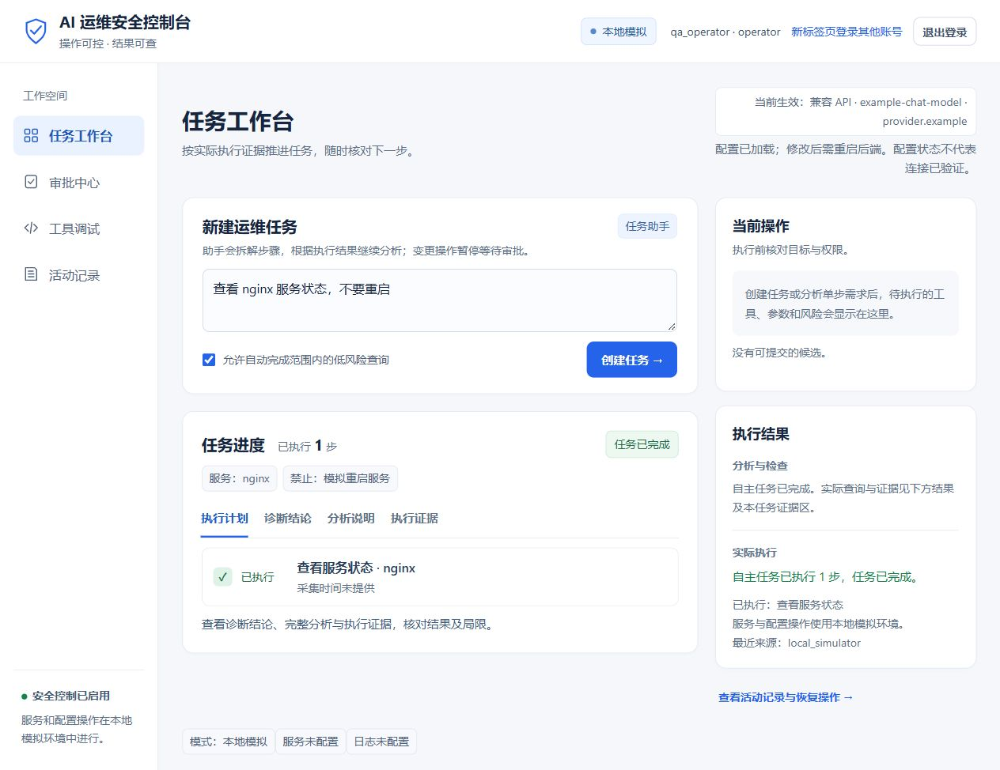
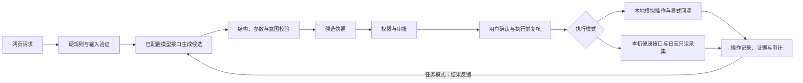

# AI 运维 Agent 安全控制

面向 AI 运维 Agent 的工具调用安全控制参考实现：将请求转换为白名单操作候选，经过规则、权限和人工审批，在明确的任务范围内执行、核验并记录证据。

适合学习 Agent 安全、演示审批与测试提示注入防护。现支持本地账号登录、归属校验和自主多步任务；默认使用本地模拟环境，尚不适合生产运维。

新增可显式启用的**真实本机只读诊断**：请求维护者配置的健康接口、读取精确映射的真实日志，并根据实际证据决定是否继续查日志或磁盘。该模式拒绝重启、配置修改与回滚；不带配置启动仍使用模拟模式。可用真实 Python 测试服务复现 HTTP 503 → 日志取证 → 磁盘核对，无需 Docker。启动、四种场景和自定义资源配置见 [真实只读诊断指南](docs/REAL_DIAGNOSTICS.md)。

原创代码采用 [MIT 许可证](LICENSE)。提供 Windows / Linux 自动检查配置；公开仓库的实际检查状态以 GitHub Actions 记录为准。

## 工作台预览



界面示例使用合成 API 响应与本地模拟服务，未调用外部模型平台。任务、审批、工具调试和活动记录分别展示；任务进度按实际记录显示，计划不计入已执行步数。完整分析、默认参数和执行证据可通过对应标签查看。

## 主要能力

- 硬规则与模型风险取高；Guardrails AI 检查输入、候选结构、参数和请求一致性。
- 服务端候选快照默认 15 分钟有效，拒绝前端改写风险与参数。
- 工具白名单、角色限制、独立人员审批、候选与审批令牌一次性消费。
- 本地查询、模拟服务重启、沙箱配置更新、显式回滚与哈希链审计。



## 安装与启动

使用 Python 3.12。已在本地 Windows 验证；Linux 路径已适配，提供 Windows / Linux CI 工作流，实际跨平台结果以 GitHub 运行记录为准。Node.js 仅供页面脚本测试使用，网页运行本身不需要它。

在项目根目录运行：

```bash
python scripts/setup.py
```

脚本创建核心与 Guardrails AI 两个独立虚拟环境。`requirements.txt` 与 `requirements-core.txt` 均指向当前核心应用依赖；仅安装根目录依赖不会安装独立的 Guardrails 环境，因此首次使用推荐执行上面的安装脚本。

首次启动前创建登录账号，密码由终端隐藏输入：

```powershell
.\.venv\Scripts\python.exe scripts/manage_users.py alice operator
.\.venv\Scripts\python.exe scripts/manage_users.py bob approver
```

管理员可另建，角色为 admin；Linux 使用 `.venv/bin/python`。完整操作见 [登录与自主任务指南](docs/AUTONOMOUS_TASKS.md)。

Windows：

```powershell
.\.venv\Scripts\python.exe local_app.py
```

Linux / macOS：

```bash
.venv/bin/python local_app.py
```

浏览器打开 http://127.0.0.1:8765 ，Windows 也可双击 run-local-app.bat。服务仅监听本机。

默认使用 DeepSeek 官方 API 的 DeepSeek-V4.1-Flash，API 模型名为 `deepseek-flash`。配置后端密钥即可，无需下载或启动本地模型：

```powershell
Copy-Item .env.example .env
# 编辑 .env，填写 DEEPSEEK_API_KEY 后重新启动后端。
```

也可使用自己的其他 **HTTPS Chat Completions 兼容 API**：将 `LLM_PROVIDER` 改为 `openai_compatible`，填写独立的 `LLM_BASE_URL`、`LLM_MODEL` 和 `LLM_API_KEY`。兼容模式不会代用 DeepSeek 密钥；配置示例、JSON/token 选项与协议限制见 [模型服务配置](docs/MODEL_CONFIGURATION.md)。

网页显示后端**当前生效**的服务、模型和主机名；配置更改后需重启后端并重新登录。配置变更尚未生效或新配置无效时会明确提示，不自动替换正在运行的任务模型。密钥是否配置不代表连接或余额已经验证。

也可直接设置环境变量；环境变量优先于 `.env`。密钥仅由后端读取，不会返回网页或包含在源码导出中。配置改变后重新启动后端：

| 变量 | 默认值 | 用途 |
| --- | --- | --- |
| LLM_PROVIDER | deepseek | 可选 deepseek、openai_compatible、ollama |
| DEEPSEEK_API_KEY | 无 | 官方 API 密钥 |
| DEEPSEEK_MODEL | deepseek-flash | DeepSeek-V4.1-Flash 的官方 API 模型名 |
| DEEPSEEK_BASE_URL | https://api.deepseek.com | 官方 HTTPS 地址，可带 /v1 |
| LLM_BASE_URL / LLM_MODEL | 无 | 兼容模式的 HTTPS 基础地址与模型 ID，必须自行填写 |
| LLM_API_KEY | 无 | 兼容模式独立密钥，不代用 DeepSeek 密钥 |
| LLM_JSON_MODE | json_object | 兼容模式可显式改为 prompt_only |
| LLM_TOKEN_LIMIT_PARAM | max_tokens | 兼容模式可改为 max_completion_tokens |
| LLM_TIMEOUT_SECONDS | 30 | 每次云端请求超时，范围1～120秒 |
| LLM_MAX_TOKENS | 4096 | 输出上限，范围1～16384 |
| GUARDRAILS_AI_PYTHON | 验证器目录下 .venv 中的 Python | 覆盖独立验证环境路径 |

云端接口故障时，可以用调试表单生成候选；自然语言入口只有在输入验证通过后，才对完整匹配的常见只读请求启用规则兜底。不会自动改用 Ollama。Guardrails 环境缺失、校验失败或超时仍拒绝自然语言候选，不会绕过验证。只体验手动流程可使用 `python scripts/setup.py --core-only` 安装核心依赖。详细配置与故障排查见 [DeepSeek API 指南](docs/DEEPSEEK_API.md)。

## 试用

### 多步骤任务模式

“任务工作台”支持追问缺失信息、展示计划、逐步调用工具，并把执行结果交回模型决定下一步或总结。例如输入“帮我排查 nginx 异常，先看状态，再检查磁盘和最近2行错误日志”。

勾选只读自动权限，审阅初始计划后点击“启动自主执行”。低风险查询连续执行，结果交回模型再规划；变更或中高风险步骤会创建申请并暂停，独立账号批准后继续并核验。也可逐步手动执行。缺少信息时先追问，诊断目标本身不能授权变更。单任务最多6步、补充4次、15分钟有效；可停止，重复动作会被拦截。

工具、风险、参数和默认日志资源统一配置在 `policy/tools.yml`。任务助手展示目标、默认资源、禁止事项与未完成步骤，防止漏执行后直接报告完成；实际重启后必须再次查询状态。输出格式将工具与参数绑定，校验失败最多纠正一次。停止或退出登录会作废待执行任务候选。测试输入与预期见 [任务验收清单](docs/TASK_WORKFLOW_TESTS.md)。

任务模式需要可用模型 API 与 Guardrails AI。观察结果不能替代用户授权，证据会截断并按规则隐藏常见凭据。默认模型在云端推理；本地后端按启动配置使用模拟模式或真实只读模式。下面的工具示例以默认模拟模式为准。

| 输入 | 工具 | 说明 |
| --- | --- | --- |
| 查看当前磁盘使用情况 | check_disk | 读取沙箱所在磁盘的实际容量 |
| 查看 nginx 服务状态 | get_service_status | 读取模拟服务状态 |
| 查看 nginx 最近两行错误日志 | read_log | 读取自动创建的演示日志 |
| 重启 nginx 服务 | restart_service | operator/admin 可申请，需独立审批；增加模拟重启计数 |
| 修改 /etc/myapp/test.conf 配置，完整内容：log_level=info | update_config | admin 可申请，需独立审批；修改沙箱内文件 |

点击“分析并检查”后核对方案。allow 可确认执行；require_human 先申请，由不同申请人的管理员或审批员批准后再确认；deny 不执行。模型输出也可能因信息不足或校验失败被拒绝。

服务白名单为 nginx、payment、api。自定义日志请求需完整路径和数字行数；配置更新需目标路径和“完整内容：”后的全文。任意其他请求不保证能生成候选。

## 阅读代码

| 文件 / 目录 | 职责 |
| --- | --- |
| web/index.html | 网页交互、权限检查、确认执行 |
| web/workbench.js、web/workbench.css | 导航、紧凑步骤列表和任务信息展示 |
| local_app.py | HTTP 接口与应用协调 |
| natural_language_agent.py | 候选生成、模型调用与只读兜底 |
| guardrails_output_validator.py | 独立验证进程和异常处理 |
| reproductions/guardrails_ai/ | Guardrails 接入和自定义验证器 |
| hybrid_policy.py、policy/ | 硬规则、工具规则和风险取高 |
| candidate_store.py | 服务端候选快照 |
| structured_tools.py、secure_tool_service.py | 参数、权限和审批授权 |
| approval_manager.py | 审批与一次性令牌 |
| sandbox_executor.py | 本地查询、模拟变更与恢复 |
| real_diagnostics.py、diagnostic_reasoning.py | 真实只读采集、证据评估和后续取证要求 |
| audit_log.py | 哈希链审计 |
| tests/ | 单元、HTTP、真实验证器和页面脚本回归 |

建议先读 local_app.py 的 interpret → check → execute，再读网关、审批和执行器。见 [架构与边界](docs/ARCHITECTURE.md)。

## 验证

无需 Ollama，核心测试使用固定模型返回值；真实 Guardrails 测试使用独立环境，页面脚本测试使用 Node.js。缺失可选环境会显示跳过，不能算对应能力已验证。

```powershell
# Windows；Linux 使用 .venv/bin/python
.\.venv\Scripts\python.exe -B -m unittest discover -v -s tests -p "test_*.py"
.\reproductions\guardrails_ai\.venv\Scripts\python.exe -B reproductions/guardrails_ai/validate_output.py --demo
.\.venv\Scripts\python.exe -B full_safety_demo.py
```

完整演示在临时沙箱执行，报告写到 evaluations/demos/；网页数据写到 data/web_runtime/。运行数据不会进入源码导出目录。

发布前还可以直接验证干净的导出包：

```bash
python scripts/verify_release.py --output dist/release-check
```

该命令要求 Python 3.12 和用于页面测试的 Node.js，在新目录导出源码、安装两个新环境、验证真实 Guardrails 并运行整套测试。安装依赖需要联网，测试不需要真实模型密钥。验证目录包含虚拟环境，不作为上传目录；出现跳过项时需核对原因。详细步骤见 [发布说明](docs/PUBLISHING.md)。

## 开源项目的使用范围

- [Guardrails AI](https://github.com/guardrails-ai/guardrails)：网页主链实际调用 Python 库，运行本地自定义验证器；Pydantic 严格检查原始候选结构。
- [NeMo Guardrails](https://github.com/NVIDIA/NeMo-Guardrails)：原研究的独立围栏实验，网页主链未直接调用其运行时。
- [AgentDojo](https://github.com/ethz-spylab/agentdojo)：原研究的离线任务与攻击样本来源，只测请求解释与候选生成，不是完整官方基准。

精简发布版包含网页主链与测试，保留 Guardrails 接入；NeMo / AgentDojo 历史实验及结果留在本地研究目录，不由源码导出器打包。本地 NeMo 实验依赖保存在 `reproductions/nemo_guardrails/requirements.txt`，不属于当前应用的安装步骤。

## 发布与贡献

`python scripts/export_github.py` 生成全新的 dist/ai-ops-safety/。目录只包含允许的源码与文档，不含 PPT、虚拟环境、审批令牌或运行数据。见 [发布说明](docs/PUBLISHING.md)、[贡献说明](CONTRIBUTING.md) 和 [第三方说明](THIRD_PARTY_NOTICES.md)。

原创代码采用 MIT 许可证，版权署名为 `hjj061216`。第三方依赖保持各自许可证，MIT 授权不替代上游声明。

## 当前限制

已实现本地密码账号、会话、服务端角色与归属校验，尚无企业 SSO、MFA 和完整账号管理界面。审计与变更不是原子事务，哈希链不是外部不可篡改存证。

模拟器使用本地文件和模拟服务状态，不运行任意 Shell，不连接真实系统服务。控制台仅监听本机 HTTP，不作为公网服务。详见 [安全说明](SECURITY.md)。

真实只读模式第一版仅接受维护者预先配置的 `127.0.0.1` 健康地址和已存在的常规日志文件；不会将网页或模型提供的任意 URL、主机路径作为读取目标。HTTP成功仅证明端点响应，日志错误仅是线索。采集结果发送至已配置云模型前会按规则隐藏常见凭据，但规则无法保证识别所有敏感信息，配置前应自行确定可发送的诊断范围。
